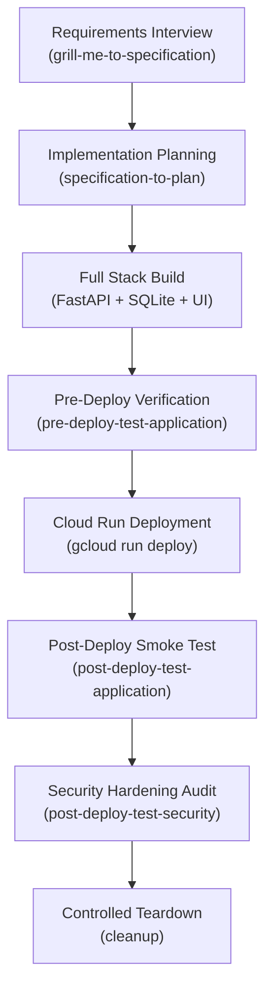

# 📖 Cloud Run Guestbook Application (`agy_guestbook`)

A production-tested, containerized Guestbook web service designed, planned, implemented, tested, deployed to **Google Cloud Run**, and cleanly decommissioned using **Antigravity (AGY)** and its agentic skill workflows.

[](https://www.python.org/)
[](https://fastapi.tiangolo.com/)
[-brightgreen.svg)]()
[]()
[]()

---

## 🧭 Project Status: Decommissioned via `cleanup` Skill

This project has completed its full lifecycle demonstration:
* The live Cloud Run service (`guestbook-app`) was successfully deployed, audited, and subsequently **safely deleted**.
* The application source and runtime files were cleaned up following test verification.
* **All design artifacts, test reports, security scorecards, operational logs, and custom skills are fully preserved** in this repository and history.

---

## 🛠️ Complete Project Walkthrough: Steps & Skills Executed

This project demonstrated an end-to-end disciplined agentic development lifecycle driven by specialized agent skills:



### 1. Requirements Interview (`grill-me-to-specification`)
- Conducted an interactive requirements interview to align on architecture and constraints:
  - **Service Name:** `guestbook-app`
  - **Cloud Run Region:** `us-west1` (Project: `hardy-messenger-510318-u4`)
  - **Tech Stack:** Python 3.12, FastAPI, Jinja2 templates, modern CSS.
  - **Storage:** Local SQLite in WAL mode (`/app/data/guestbook.db`).
  - **Ingress:** Public unauthenticated (`--allow-unauthenticated`).
- **Emitted Document:** [`SPECIFICATION.md`](SPECIFICATION.md) defining architecture, data models, edge cases, and API contracts.

### 2. Implementation Planning (`specification-to-plan`)
- Evaluated codebase state and formulated a 5-phase execution plan: Scaffolding, Data Layer, UI/Routes, Verification, and Containerization.
- **Emitted Document:** [`PLAN.md`](PLAN.md) with an actionable, sequential checklist.

### 3. Application Implementation
- **Backend & Routing (`app/main.py`)**: Built async FastAPI endpoints for rendering the guestbook (`GET /`), accepting form submissions via Post/Redirect/Get (`POST /entries`), headless JSON retrieval (`GET /api/v1/entries`), and health probes (`/health`, `/api/healthz`, `/healthz`).
- **Persistence & Sanitization (`app/models.py`)**: SQLite with `PRAGMA journal_mode=WAL;` and Pydantic validation (names 1-50 chars, valid email syntax, messages 1-500 chars). HTML entities sanitized via `html.escape`.
- **Frontend UI (`app/templates/index.html` & `app/static/style.css`)**: Mobile-responsive cards layout, form validation feedback, signature counter badge, and date formatting.
- **Security Middleware (`app/main.py`)**: Added security headers on every response:
  - `Content-Security-Policy: default-src 'self'; style-src 'self' 'unsafe-inline'; img-src 'self' data:; script-src 'self';`
  - `X-Content-Type-Options: nosniff`
  - `X-Frame-Options: DENY`
  - `Referrer-Policy: strict-origin-when-cross-origin`
  - `X-XSS-Protection: 1; mode=block`
- **Containerization (`Dockerfile`)**: Lightweight `python:3.12-slim` base image, unprivileged `appuser:1000` execution, dynamic Cloud Run `$PORT` binding.

### 4. Pre-Deployment Verification (`pre-deploy-test-application`)
- Built an automated test suite in `tests/test_app.py` using `pytest` and `httpx.AsyncClient` with isolated temporary SQLite databases.
- Executed 6 automated verification suites:
  - Health check probe validation (`/healthz`).
  - Web UI template rendering & security header verification.
  - Form submission & Post/Redirect/Get redirect flow.
  - **XSS Sanitization**: Probed with `<script>` and `` injection payloads to confirm escaping into HTML entities.
  - Validation failure checks (malformed email, blank inputs returning HTTP 422).
  - Python bytecode syntax compilation check.
- **Emitted Document:** [`PRE-TEST.md`](PRE-TEST.md) (100% pass rate, **Verdict: GO**).

### 5. Google Cloud Run Deployment
- Deployed the container directly from local source via Google Cloud Build to Cloud Run:
  ```bash
  gcloud run deploy guestbook-app \
      --source . \
      --region us-west1 \
      --project hardy-messenger-510318-u4 \
      --allow-unauthenticated \
      --quiet
  ```
- Traffic routed 100% to live revision `guestbook-app-00002-l82`.

### 6. Post-Deployment Verification (`post-deploy-test-application`)
- Executed non-destructive live synthetic probes against the production service:
  - Probed `/health` and `/api/healthz` (200 OK, latency < 25ms).
  - Executed live form submission (`POST /entries`) with test author `"Cloud Run Tester"`.
  - Verified persistence via `GET /api/v1/entries` and validated DOM rendering on `GET /`.
- **Emitted Document:** [`POST-TEST.md`](POST-TEST.md) (**Verdict: HEALTHY**).

### 7. Post-Deployment Security Audit (`post-deploy-test-security`)
- Evaluated transport encryption: verified active TLSv1.3 with Google Trust Services (`WE2`).
- Audited HTTP security headers against the scorecard (`CSP`, `nosniff`, `DENY`, `strict-origin-when-cross-origin`).
- Probed sensitive administrative and environment endpoints (`/.env`, `/.git/`, `/admin`) to verify they return clean 404 responses without stack traces or information leakage.
- **Emitted Document:** [`POST-SECURITY.md`](POST-SECURITY.md) (**Verdict: APPROVED / SECURE**).

### 8. Teardown & Resource Cleanup (`cleanup`)
- Invoked the custom `cleanup` skill to safely decommission the cloud footprint and workspace:
  - Prompted for and obtained explicit user approval before each destructive operation.
  - Terminated the deployed Cloud Run service (`gcloud run services delete guestbook-app --region us-west1`).
  - Reset local databases and cleaned up application source code files.
  - Strictly preserved all user-defined agent skills and documentation artifacts.

---

## 📂 Repository Artifacts & Documentation Map

```
├── SPECIFICATION.md            # Technical specification & architectural trade-offs
├── PLAN.md                     # Phased implementation & verification plan
├── PRE-TEST.md                 # Pre-deployment verification audit (all 6 suites passed)
├── POST-TEST.md                # Post-deployment live smoke & probe verification (Healthy)
├── POST-SECURITY.md            # Post-deployment security audit & header scorecard (Secure)
├── LOG.md                      # Chronological execution log of all skills, tools & steps
├── AGENTS.md                   # Operational guide & architectural blueprint for future AI agents
├── .gitignore                  # Git exclusions (.venv, *.db, cache)
└── README.md                   # Complete project summary & lifecycle guide
```

---

## 🤖 Defined Skills Reference

The following custom skills were defined, installed, and executed during this project:

| Skill | Purpose |
| :--- | :--- |
| **`grill-me-to-specification`** | Conducts adversarial requirements interviews and emits `SPECIFICATION.md`. |
| **`specification-to-plan`** | Analyzes specifications and emits a phased, actionable checklist in `PLAN.md`. |
| **`pre-deploy-test-application`** | Authors and runs automated test suites (pytest), emitting results to `PRE-TEST.md`. |
| **`post-deploy-test-application`** | Executes live synthetic probes and journeys on deployed services, emitting `POST-TEST.md`. |
| **`post-deploy-test-security`** | Audits TLS, security headers, and endpoint protection, emitting `POST-SECURITY.md`. |
| **`cleanup`** | Deletes cloud services and resets workspaces with step-by-step user confirmation while preserving skills. |

---

## 📜 License
This project is open-source and available under the [MIT License](LICENSE).
