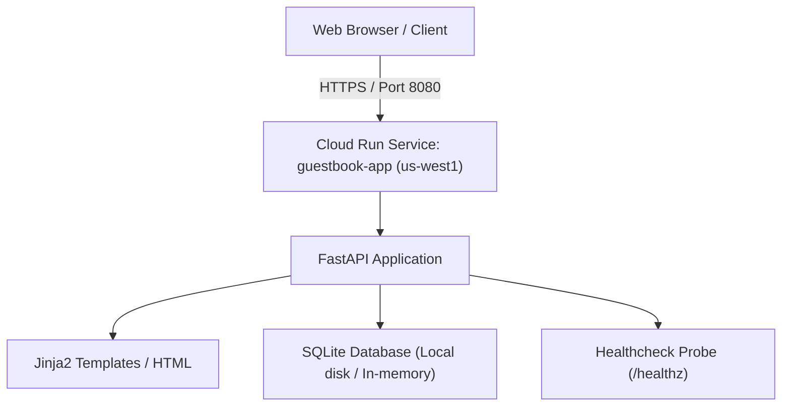

# Technical Specification: Guestbook Application on Cloud Run

**Document:** SPECIFICATION.md  
**Deployment Service Name:** `guestbook-app`  
**Target GCP Region:** `us-west1`  
**GCP Project:** `hardy-messenger-510318-u4`  
**Status:** Approved / Finalized via `@skill:grill-me-to-specification`  

---

## 1. Overview & Objectives

### 1.1 Summary
A lightweight, containerized guestbook web application deployed on Google Cloud Run. Visitors can view past guestbook submissions and post new entries with their name, email, and message.

### 1.2 Goals
- Provide an interactive, responsive web interface for viewing and submitting guestbook entries.
- Implement robust input validation and HTML sanitization to prevent Cross-Site Scripting (XSS) and injection attacks.
- Expose standardized liveness/readiness health check endpoints (`/healthz`).
- Containerize using a multi-stage or lean Dockerfile optimized for fast cold starts on Cloud Run.
- Configure public unauthenticated ingress for standard browser access.

### 1.3 Non-Goals / Out of Scope
- External database clustering (using a local SQLite/in-memory database instance suitable for standalone demo deployment).
- User login / OAuth / complex identity provider integrations.
- Email verification / sending emails to visitors.

---

## 2. Architecture & Design Decisions

### 2.1 System Architecture

### 2.2 Key Decisions & Trade-offs
- **Language & Framework**: Python 3.11+ with **FastAPI** and **Uvicorn** for async request handling, built-in Pydantic validation, and low memory footprint.
- **Templates / UI**: Jinja2 HTML templates styled with modern, clean responsive CSS.
- **Persistence**: SQLite on persistent/ephemeral instance disk (`/app/data/guestbook.db`), initializing automatically on startup.
- **Access Control**: Public unauthenticated access (`--allow-unauthenticated`) on Cloud Run to permit direct visitor engagement.
- **Security Posture**:
  - HTML escaping/sanitization using standard library tools (`html.escape`).
  - Standard HTTP security headers configured (nosniff, X-Frame-Options, HSTS).

---

## 3. Data Models & Interface Contracts

### 3.1 Entry Schema
| Field | Type | Constraints / Rules | Description |
| :--- | :--- | :--- | :--- |
| `id` | Integer | Primary Key, Auto-increment | Unique identifier |
| `name` | String | 1 - 50 characters, required | Visitor's display name |
| `email` | String | Valid email format, required | Visitor's email address |
| `message` | String | 1 - 500 characters, required | Guestbook comment |
| `created_at` | DateTime | Default UTC now | Submission timestamp |

### 3.2 HTTP API & Routes
- `GET /`: Renders the guestbook homepage displaying historical entries ordered newest-first and the submission form.
- `POST /entries`: Handles form submission, validates inputs via Pydantic, inserts the record, and redirects back to `/` (Post/Redirect/Get pattern).
- `GET /api/v1/entries`: Returns JSON list of recent guestbook entries.
- `GET /healthz`: Health check endpoint returning `{"status": "healthy"}` for container liveness and readiness probes.

---

## 4. Edge Cases & Failure Modes
- **Input Validation Failure**: Missing or malformed email/name/message returns HTTP 422 with clear user-facing error feedback.
- **XSS Attempts**: All inputs are sanitized and escaped prior to rendering in Jinja templates (`autoescape=True`).
- **High Concurrency / SQLite Concurrency**: SQLite configured in WAL mode with timeout handling to prevent database lock contention.
- **Container Cold Starts**: Minimal dependencies and lightweight base image (`python:3.11-slim`) to maintain sub-second startup latency.

---

## 5. Security & Operational Considerations
- **Cloud Run Port**: Service listens on `0.0.0.0:$PORT` (defaults to 8080).
- **Graceful Shutdown**: Handles `SIGTERM` signals emitted by Cloud Run when scaling down.
- **Logging**: Structured JSON or clean stdout logging for Cloud Logging ingestion.

---

## 6. Implementation Milestones
- [x] Requirements alignment and architectural specification.
- [ ] Phase 1: Implementation Plan generation via `@skill:specification-to-plan`.
- [ ] Phase 2: Application code, database schema, templates, and Dockerfile creation.
- [ ] Phase 3: Pre-deployment testing via `@skill:pre-deploy-test-application`.
- [ ] Phase 4: Container build and Cloud Run deployment.
- [ ] Phase 5: Post-deployment testing via `@skill:post-deploy-test-application`.
- [ ] Phase 6: Post-deployment security audit via `@skill:post-deploy-test-security`.
